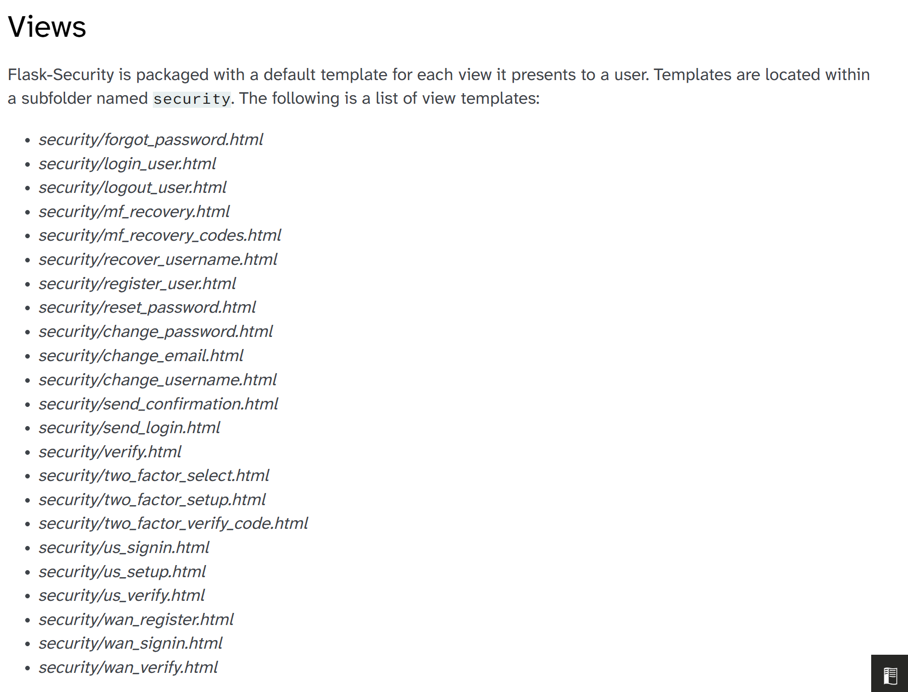

ToDo List
-

- User registration:
  - ~~Database for user information~~
  - ~~Setup password hashing~~
  - ~~user registration login window~~
  - manage sessions
- Landing page (If first time):
  - create new league feature
    - how many bots
    - what leagues' players
- Home Page:
  - My team page
    - team with starting XI, bench, injury reserve, taxi squad
    - each player's bio
  - League
    - only members of league can access. Code locked or something.
  - Players (search players)
    - uses same player bio as my team
- User Profile:
  - logout
  - delete account
- Creation of bots:
  - way to choose players in draft:
- Privacy Policy & etc...

----
API
-
We will use Sports APIs' Football API.

API's documentation: https://api-sports.io/documentation/football/v3#section/Introduction

Another 200 requests/day option is

https://www.football-charts.com/developers

Maybe we can use one after the other is depleted.

-----

For Security:
-
Flask-Security-Too Library From Flask:

https://gemini.google.com/app/5a8d4b08da578cd2

Documentation:

https://pypi.org/project/Flask-Security/

Installation of library from pip

	pip install -U Flask-Security

Features;

https://flask-security.readthedocs.io/en/stable/features.html

- Password hashing
- Session (tokens)

-----
Terms of Service generator:
-

https://www.lawdepot.ca/business/website-terms-and-conditions/?pid=googleppc-147942022475-814100669495_sl-ggkey_terms%20of%20use%20generator&webuser_data_id=218533205

----
Libraries to install:
-
- Flask
- Flask-Security-Too
- Bcrypt-flask
- Bleach
- For teammates pulling these changes: Have them run pip install python-dotenv and copy .env.example to .env with their own local keys.